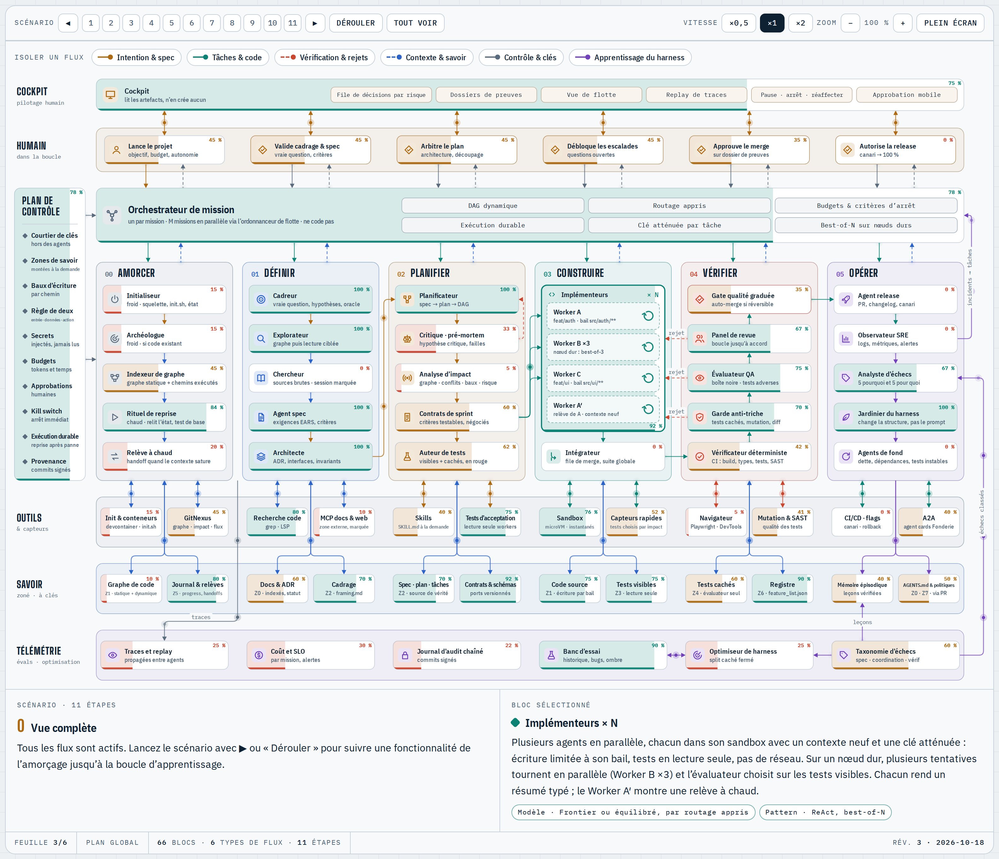
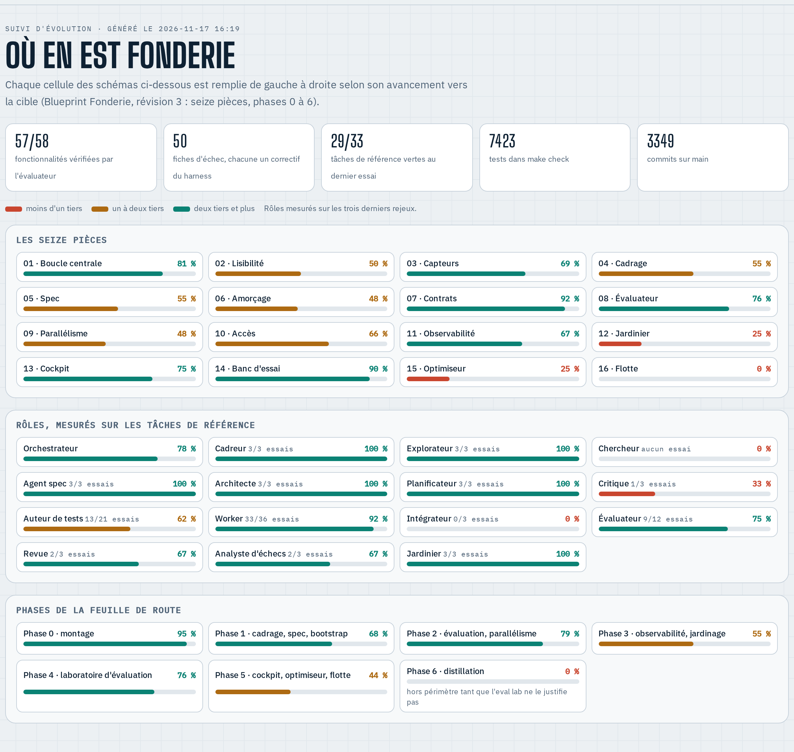

# Fonderie

**Harness multi-agents pour le génie logiciel complexe**, monté sur Claude Code : Claude orchestre, des
modèles locaux (Qwen via Ollama, sur une RTX 5090) exécutent, un évaluateur indépendant atteste. La
fiabilité vient des contrats, des permissions et des capteurs, pas du prompt.

> **Vitrine.** Le code est dans un dépôt privé. Démo ou accès sur demande, pour un entretien technique
> par exemple : [cyril.bgs.dev@gmail.com](mailto:cyril.bgs.dev@gmail.com?subject=Fonderie%20%3A%20demande%20de%20d%C3%A9mo)

## Plan global haute résolution, avec le niveau atteint

**[Ouvrir le plan interactif](https://cyril-bgs-dev-tech.github.io/fonderie/)** : scénario en 11 étapes,
flux isolables, vitesse, zoom, plein écran. Un clic sur un bloc donne son rôle, la gamme de modèle
conseillée et sa vue locale : ce qui est fait et ce qui reste.

Chaque bloc est rempli de gauche à droite selon son avancement vers la cible (blueprint, révision 3) :
rouge sous un tiers, ocre jusqu'aux deux tiers, vert au-delà.

## Où en est le projet (17 novembre 2026)

- **57 fonctionnalités sur 58** validées par l'évaluateur indépendant, en boîte noire et avec des tests cachés
- **50 échecs analysés**, chacun avec un correctif structurel du harness
- **29 tâches de référence sur 33** vertes au dernier essai
- **7 423 tests**

---
Cyril Bourgeois, Data Scientist et ingénieur ML ·
[Portfolio](https://cyril-bgs-dev-tech.github.io/Portfolio/) ·
[LinkedIn](https://www.linkedin.com/in/cyril-bourgeois-65a739150) ·
[Kaggle](https://www.kaggle.com/cyrilbourgeois)
